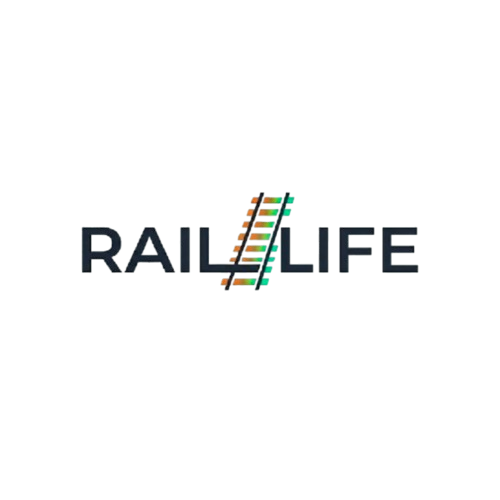

<div align="center">



# RAILLIFE

**Monitoramento inteligente e gerenciamento ferroviário em tempo real.**


[Site do projeto](https://renatolvicente-lang.github.io/RAILLIFE/) · [Reportar um problema](https://github.com/renatolvicente-lang/raillife/issues)

</div>

---

## Sumário

- [Sobre o projeto](#sobre-o-projeto)
- [Funcionalidades](#funcionalidades)
- [Tecnologias](#tecnologias)
- [Metodologia](#metodologia)
- [Estrutura do repositório](#estrutura-do-repositório)
- [Como executar](#como-executar)
- [Roadmap](#roadmap)
- [Licença](#licença)
- [Créditos](#créditos)

## Sobre o projeto

O **RAILLIFE** é um sistema web de gerenciamento ferroviário. Ele foi pensado para facilitar o monitoramento e a administração das informações de uma operação ferroviária: por meio de **sensores IoT**, os dados são coletados em tempo real e apresentados de forma organizada em um painel de controle.

O sistema oferece operações **CRUD** (criar, consultar, atualizar e remover) para o rastreamento de **trens**, **sensores** e **rotas**, com os dados armazenados em um **banco de dados relacional**.

## Funcionalidades

- **Painel de controle** com visão centralizada da operação ferroviária.
- **Gerenciamento de trens:** cadastro, consulta, edição e exclusão de trens.
- **Gerenciamento de sensores:** controle dos sensores IoT associados à operação.
- **Gerenciamento de rotas:** administração das rotas ferroviárias.
- **Monitoramento em tempo real** dos dados coletados pelos sensores.
- **Autenticação de usuários:** telas de cadastro e login.
- **Gerenciamento de usuários** do sistema.
- **Relatórios** *(em planejamento)*.

> Algumas funcionalidades ainda estão em desenvolvimento. Consulte o [Roadmap](#roadmap) para acompanhar o andamento.

## Tecnologias

| Camada | Tecnologia |
| --- | --- |
| Backend | PHP |
| Frontend | HTML, CSS e Bootstrap 5 |
| Banco de dados | Relacional |
| Dados em tempo real | Sensores IoT |
| Versionamento | Git e GitHub |

## Metodologia

O desenvolvimento segue o modelo **Espiral**, combinado com o **Scrum** como metodologia ágil, com entregas incrementais e revisão contínua do projeto.

## Estrutura do repositório

```text
raillife/
├── .vscode/      # Configurações do editor
├── assets/       # Imagens, logo e estilos (CSS)
├── database/     # Recursos do banco de dados
├── doc/          # Documentação do projeto
├── infra/        # Infraestrutura
├── public/       # Páginas da aplicação (home, trens, sensores, rotas)
├── scripts/      # Scripts auxiliares
├── index.php     # Página de apresentação
├── LICENSE       # Licença MIT
└── README.md
```

## Como executar

### Pré-requisitos

- [PHP](https://www.php.net/downloads) instalado
- Servidor web local com suporte a PHP (por exemplo, Apache via XAMPP ou o servidor embutido do PHP)
- Sistema de banco de dados relacional
- [Git](https://git-scm.com/)

### Passo a passo

1. Clone o repositório:

   ```bash
   git clone https://github.com/renatolvicente-lang/raillife.git
   cd raillife
   ```

2. Crie o banco de dados e importe a estrutura disponível na pasta `database/`.

3. Ajuste as credenciais de conexão com o banco de dados conforme o seu ambiente.

4. Inicie o servidor local. Com o servidor embutido do PHP:

   ```bash
   php -S localhost:8000
   ```

5. Acesse no navegador:

   ```text
   http://localhost:8000
   ```

## Roadmap

- [x] Página de apresentação do projeto
- [x] Páginas de administração de trens, sensores e rotas
- [ ] Atualização do README
- [ ] Refatoração das telas de cadastro e de login
- [ ] Frontend e backend da tela de cadastro
- [ ] Frontend e backend da tela de login
- [ ] Frontend e backend da tela de gerenciamento de usuários
- [ ] Módulo de relatórios

## Licença

Este projeto está licenciado sob a licença **MIT**. Consulte o arquivo [LICENSE](LICENSE) para mais detalhes.

## Créditos

Projeto desenvolvido pelos alunos:

<ul>
  <li>Arthur Roeder</li>
  <li>Gustavo Henrique Fenske</li>
  <li>Mateus de Lima dos Santos</li>
  <li>Renato L. Vicente</li>
</ul>