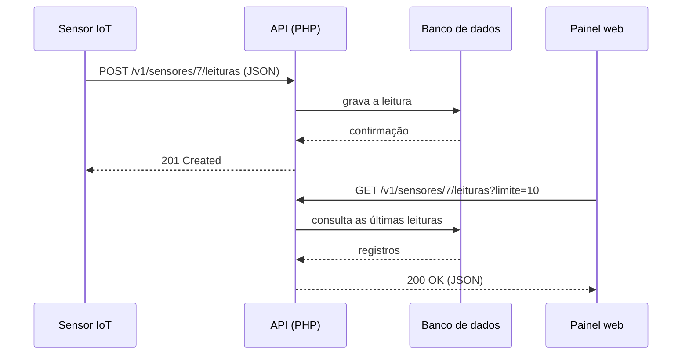

# APIs: conceitos, REST, HTTP, JSON e segurança

**Projeto:** RAILLIFE
**Tema:** Pesquisa sobre APIs (Application Programming Interfaces)
**Data:** 21 de outubro de 2026

> **Nota sobre os exemplos.** Os exemplos de URLs, campos JSON e código usam o domínio do RAILLIFE (trens, sensores e rotas), mas são **didáticos e hipotéticos**: os nomes de endpoints, tabelas e campos não descrevem o sistema real. O domínio `api.raillife.example` usa o sufixo reservado `.example` e não existe na internet.

---

## Sumário

1. [O que é uma API e qual é sua finalidade](#1-o-que-é-uma-api-e-qual-é-sua-finalidade)
2. [Como funciona a comunicação entre sistemas por meio de APIs](#2-como-funciona-a-comunicação-entre-sistemas-por-meio-de-apis)
3. [O que são APIs REST](#3-o-que-são-apis-rest)
4. [O papel dos métodos HTTP](#4-o-papel-dos-métodos-http)
5. [Requisições e respostas HTTP](#5-requisições-e-respostas-http)
6. [O que são endpoints](#6-o-que-são-endpoints)
7. [Troca de dados em JSON](#7-troca-de-dados-em-json)
8. [Diferenças entre uma API e um sistema web tradicional](#8-diferenças-entre-uma-api-e-um-sistema-web-tradicional)
9. [Como uma aplicação PHP pode consumir uma API](#9-como-uma-aplicação-php-pode-consumir-uma-api)
10. [Como uma API pode disponibilizar informações para outros sistemas](#10-como-uma-api-pode-disponibilizar-informações-para-outros-sistemas)
11. [Autenticação, autorização e segurança](#11-autenticação-autorização-e-segurança)
12. [Exemplos de uso de APIs em sistemas empresariais](#12-exemplos-de-uso-de-apis-em-sistemas-empresariais)
13. [Conclusão](#13-conclusão)
14. [Referências](#referências)

---

## 1. O que é uma API e qual é sua finalidade

Uma **API** (*Application Programming Interface*, ou Interface de Programação de Aplicações) é um conjunto de funcionalidades e regras que existem dentro de um software e permitem interagir com ele por meio de **outro software**, em vez de por uma interface de usuário voltada a pessoas. Pode ser entendida como um **contrato** entre a aplicação que a oferece e outros programas ou equipamentos que a utilizam (MDN WEB DOCS, 2025).

No desenvolvimento web, uma API costuma ser um conjunto de recursos de código (métodos, propriedades, eventos e URLs) que o desenvolvedor usa para interagir com o navegador, com outros programas ou com serviços de terceiros (MDN WEB DOCS, 2025). Neste trabalho, o foco são as **APIs web**, acessadas por meio do protocolo HTTP.

### Finalidades principais

- **Integração:** sistemas desenvolvidos separadamente (e muitas vezes em linguagens diferentes) trocam dados sem conhecer o código um do outro.
- **Abstração e encapsulamento:** o HTTP oculta os detalhes de como um serviço é implementado e oferece uma interface uniforme, independente do tipo de recurso. Isso permite que cliente e servidor **evoluam de forma independente** (FIELDING; NOTTINGHAM; RESCHKE, 2022, seç. 1.1).
- **Reuso:** a mesma regra de negócio atende site, aplicativo móvel, painéis e equipamentos.
- **Automação:** processos que dependiam de digitação ou conferência manual passam a ser executados por programas.

### Relação com o RAILLIFE

O RAILLIFE é um sistema de gerenciamento ferroviário com CRUD para trens e sensores e menu com as áreas Trens, Sensores, Rotas e Relatórios. Sua página inicial descreve a coleta de dados de **sensores IoT** em tempo real, apresentados em um painel de controle. Uma API é o componente natural para esse cenário: os sensores enviam leituras para ela, e o painel, relatórios e outros sistemas consultam os dados por ela.

---

## 2. Como funciona a comunicação entre sistemas por meio de APIs

### O modelo cliente-servidor

O HTTP é um protocolo **cliente-servidor** de requisição e resposta. O cliente monta uma requisição que expressa sua intenção e a envia ao servidor. O servidor interpreta a mensagem em relação ao recurso alvo e responde. O cliente então examina o **código de status** e o conteúdo da resposta para decidir o que fazer em seguida (FIELDING; NOTTINGHAM; RESCHKE, 2022, seç. 1.3).

Os termos "cliente" e "servidor" descrevem apenas **papéis** em uma conexão: o mesmo programa pode ser cliente em uma conexão e servidor em outra (FIELDING; NOTTINGHAM; RESCHKE, 2022, seç. 3.3). Um sistema PHP que consulta uma API de terceiros é cliente dela e, ao mesmo tempo, pode ser servidor para o navegador do usuário.

### O fluxo de uma chamada

1. O cliente conhece o **endereço** (URL) e o **contrato** da API (quais recursos, métodos e formatos existem).
2. Abre-se uma conexão, normalmente TCP, de preferência protegida por TLS (HTTPS) (MDN WEB DOCS, 2026b).
3. O cliente envia a **requisição** (método, URL, cabeçalhos e, às vezes, um corpo).
4. O servidor valida, processa (por exemplo, consultando o banco de dados) e envia a **resposta** (código de status, cabeçalhos e, às vezes, um corpo).
5. O cliente interpreta a resposta e segue sua lógica.



### Características importantes

- **Sem estado (*stateless*):** cada requisição pode ser entendida isoladamente, sem depender das anteriores na mesma conexão (FIELDING; NOTTINGHAM; RESCHKE, 2022, seç. 3.3). Por isso, a API não deve "lembrar" quem é o cliente entre chamadas: ele se identifica a cada requisição (veja a [seção 11](#11-autenticação-autorização-e-segurança)).
- **Representações, não o recurso em si:** o que trafega é uma **representação** do estado do recurso (por exemplo, um JSON descrevendo um trem), e não o objeto interno do servidor (FIELDING; NOTTINGHAM; RESCHKE, 2022, seç. 3.2).
- **Intermediários:** entre cliente e servidor podem existir *proxies*, *gateways* e caches, que repassam ou até respondem mensagens (FIELDING; NOTTINGHAM; RESCHKE, 2022, seç. 3.7).
- **Quem inicia a conversa:** no HTTP, a requisição parte do cliente. Para que o servidor "avise" o cliente existem mecanismos adicionais, como os eventos enviados pelo servidor (*server-sent events*) (MDN WEB DOCS, 2026b) e os *webhooks*, em que um sistema chama uma URL do outro quando algo acontece.

---

## 3. O que são APIs REST

**REST** (*Representational State Transfer*) é um **estilo arquitetural**, e não um protocolo ou produto. Foi definido por Roy Fielding em sua tese de doutorado (FIELDING, 2000), cujo capítulo 5 introduz o estilo para sistemas de hipermídia distribuídos e o relaciona ao projeto da arquitetura da Web moderna. Na tese, um estilo arquitetural é "um conjunto nomeado e coordenado de restrições arquiteturais" (FIELDING, 2000, resumo, tradução nossa).

### Principais restrições do REST

De acordo com o capítulo 5 da tese de Fielding (2000), o estilo é derivado pela adição gradual das seguintes restrições:

| Restrição | Significado prático |
| --- | --- |
| **Cliente-servidor** | Interface (cliente) e armazenamento/processamento (servidor) são separados e evoluem de forma independente. |
| **Sem estado** | Cada requisição contém toda a informação necessária para ser compreendida. |
| **Cache** | Respostas podem ser marcadas como armazenáveis, reduzindo tráfego e latência. |
| **Interface uniforme** | Recursos são identificados por URIs, manipulados por representações, as mensagens são autodescritivas e a hipermídia guia o uso da aplicação. |
| **Sistema em camadas** | Intermediários (proxies, gateways) podem existir sem que cliente e servidor percebam. |
| **Código sob demanda** *(opcional)* | O servidor pode enviar código executável ao cliente. |

### APIs REST (ou "RESTful") na prática

Uma API REST aplica esses princípios sobre HTTP. Os traços mais comuns são:

- **Orientação a recursos:** a API expõe **substantivos** (trens, sensores, rotas), e não ações. O guia de projeto de APIs do Google enfatiza os recursos (modelo de dados) sobre os métodos executados neles, e recomenda poucos métodos padrão (*Get*, *List*, *Create*, *Update* e *Delete*) em vez de muitas operações customizadas (GOOGLE, [s. d.]).
- **Uso semântico do HTTP:** o método indica a ação, a URL indica o recurso e o código de status indica o resultado.
- **Representações em formato aberto**, geralmente JSON.

Cabe uma ressalva: muitas APIs chamadas de "REST" implementam apenas parte das restrições (especialmente a hipermídia). Por isso, o termo costuma ser usado de forma mais ampla do que na tese original. Existem ainda outros estilos de API, como SOAP, GraphQL e gRPC; o guia do Google, por exemplo, trata tanto de APIs REST quanto de RPC/gRPC (GOOGLE, [s. d.]).

---

## 4. O papel dos métodos HTTP

O HTTP define **métodos de requisição** que indicam o propósito da requisição e o que se espera em caso de sucesso (MDN WEB DOCS, 2026a). Em APIs REST, eles expressam as operações sobre um recurso, de forma análoga ao CRUD:

| Operação CRUD | Método HTTP |
| --- | --- |
| *Read* (ler) | `GET` |
| *Create* (criar) | `POST` |
| *Update* (atualizar, total) | `PUT` |
| *Update* (atualizar, parcial) | `PATCH` |
| *Delete* (remover) | `DELETE` |

### O que cada método faz

- **`GET`**: solicita a **representação** de um recurso. Deve apenas **recuperar dados** e não deve conter corpo na requisição (MDN WEB DOCS, 2026a).
- **`POST`**: envia uma entidade ao recurso indicado, frequentemente causando mudança de estado ou efeitos colaterais no servidor (MDN WEB DOCS, 2026a). Pede que o recurso alvo processe o conteúdo conforme sua própria semântica, o que o torna o método de uso mais geral. É o usual para **criar** um recurso dentro de uma coleção.
- **`PUT`**: pede que o estado do recurso alvo seja **criado ou substituído** pelo estado descrito na representação enviada (FIELDING; NOTTINGHAM; RESCHKE, 2022, seç. 9.3.4). É uma substituição **completa**: o que não for enviado pode ser perdido.
- **`PATCH`**: aplica **modificações parciais** a um recurso. Foi criado porque o `PUT` só permite substituição completa do documento (DUSSEAULT; SNELL, 2010). O formato do corpo do `PATCH` não é fixado pelo método; o servidor pode anunciar os formatos aceitos pelo cabeçalho `Accept-Patch`. O guia do Google recomenda que a operação de atualização padrão suporte atualização parcial e use `PATCH` (GOOGLE, [s. d.]).
- **`DELETE`**: remove o recurso indicado (MDN WEB DOCS, 2026a).

### Propriedades: seguro, idempotente e armazenável em cache

| Método | Seguro | Idempotente | Cacheável |
| --- | :---: | :---: | :---: |
| `GET` | Sim | Sim | Sim |
| `PUT` | Não | Sim | Não |
| `DELETE` | Não | Sim | Não |
| `POST` | Não | Não | Condicional* |
| `PATCH` | Não | Não | Condicional* |

\* `POST` e `PATCH` só são cacheáveis quando a resposta traz informação explícita de frescor e um cabeçalho `Content-Location` correspondente (MDN WEB DOCS, 2026a).

- **Seguro:** a semântica da requisição é essencialmente de leitura, sem alterar o estado do recurso. Um recurso não pode tratar uma requisição de forma inconsistente com o método usado: quem chama uma URL com `GET` espera que ela evite ações inseguras (FIELDING; NOTTINGHAM; RESCHKE, 2022, seç. 3.1). Por isso, um endpoint como `GET /trens/42/apagar` é um **erro de projeto**.
- **Idempotente:** enviar a mesma requisição várias vezes tem, no servidor, o mesmo efeito de enviá-la uma única vez (FIELDING; NOTTINGHAM; RESCHKE, 2022, seç. 9.2.2). A idempotência fala do **efeito no servidor**, não da resposta: um segundo `DELETE` pode retornar `404`, mas o estado final continua o mesmo.
  Essa propriedade importa na prática, pois requisições idempotentes podem ser **repetidas com segurança** após uma falha de conexão (FIELDING; NOTTINGHAM; RESCHKE, 2022, seç. 2.4). Já um `POST` repetido pode criar dois registros. Por isso, APIs de pagamento aceitam uma **chave de idempotência** para tornar `POST` repetíveis sem duplicar a operação (STRIPE, [s. d.]).

### Exemplos com JSON

Os exemplos abaixo mostram cada método aplicado a trens. Os cabeçalhos foram simplificados.

**`GET`: consultar um trem**

```http
GET /v1/trens/42 HTTP/1.1
Host: api.raillife.example
Accept: application/json
```

```http
HTTP/1.1 200 OK
Content-Type: application/json; charset=utf-8
```

```json
{
  "id": 42,
  "nome": "Locomotiva Serra Verde",
  "status": "em_operacao",
  "capacidade": 320,
  "rota_id": 3,
  "ativo": true,
  "ultima_manutencao": "2026-09-30",
  "observacoes": null
}
```

**`POST`: criar um trem**

```http
POST /v1/trens HTTP/1.1
Host: api.raillife.example
Content-Type: application/json
Authorization: Bearer <token>
```

```json
{
  "nome": "Locomotiva Vale do Itajaí",
  "capacidade": 280,
  "rota_id": 3
}
```

A resposta usual é `201 Created`, com o cabeçalho `Location` apontando para o novo recurso e, geralmente, a representação criada:

```http
HTTP/1.1 201 Created
Location: /v1/trens/43
Content-Type: application/json; charset=utf-8
```

```json
{
  "id": 43,
  "nome": "Locomotiva Vale do Itajaí",
  "status": "parado",
  "capacidade": 280,
  "rota_id": 3,
  "ativo": true,
  "ultima_manutencao": null,
  "observacoes": null
}
```

**`PUT`: substituir o trem inteiro** (todos os campos são enviados; o que faltar pode ser apagado ou assumir valor padrão)

```http
PUT /v1/trens/43 HTTP/1.1
Content-Type: application/json
```

```json
{
  "nome": "Locomotiva Vale do Itajaí II",
  "status": "parado",
  "capacidade": 300,
  "rota_id": 5,
  "ativo": true,
  "ultima_manutencao": "2026-10-15",
  "observacoes": "Revisão completa concluída."
}
```

**`PATCH`: alterar apenas o status**

```http
PATCH /v1/trens/43 HTTP/1.1
Content-Type: application/json
```

```json
{
  "status": "em_manutencao"
}
```

**`DELETE`: remover o trem.** A resposta usual é `204 No Content`, sem corpo:

```http
DELETE /v1/trens/43 HTTP/1.1
```

```http
HTTP/1.1 204 No Content
```

### Outros métodos

Existem também `HEAD` (como o `GET`, mas sem o corpo da resposta), `OPTIONS` (descreve as opções de comunicação com o recurso), `TRACE` e `CONNECT` (MDN WEB DOCS, 2026a). Se o cliente usar um método que o recurso não aceita, o servidor responde `405 Method Not Allowed` e informa os métodos aceitos no cabeçalho `Allow`.

---

## 5. Requisições e respostas HTTP

A comunicação HTTP é feita por **mensagens**: as enviadas pelo cliente são **requisições** e as enviadas pelo servidor em resposta são **respostas** (MDN WEB DOCS, 2026b).

### Estrutura da requisição

Uma requisição consiste em (MDN WEB DOCS, 2026b):

1. **Método** HTTP (`GET`, `POST` etc.);
2. **Caminho do recurso** (a URL sem o que é óbvio pelo contexto, como protocolo e domínio);
3. **Versão** do protocolo;
4. **Cabeçalhos** opcionais, com informações adicionais;
5. **Corpo** (para alguns métodos, como `POST`), com os dados enviados.

```http
POST /v1/sensores/7/leituras HTTP/1.1
Host: api.raillife.example
Authorization: Bearer <token>
Content-Type: application/json
Accept: application/json

{"valor": 68.4, "unidade": "°C", "lido_em": "2026-10-21T21:30:00-03:00"}
```

### Estrutura da resposta

Uma resposta consiste em (MDN WEB DOCS, 2026b):

1. **Versão** do protocolo;
2. **Código de status**, indicando se a requisição teve sucesso e por quê;
3. **Mensagem de status**, uma descrição curta e não normativa;
4. **Cabeçalhos**;
5. **Corpo** opcional, com o recurso solicitado.

```http
HTTP/1.1 201 Created
Content-Type: application/json; charset=utf-8
Location: /v1/sensores/7/leituras/9021

{"id": 9021, "sensor_id": 7, "valor": 68.4, "unidade": "°C", "lido_em": "2026-10-21T21:30:00-03:00"}
```

### Cabeçalhos mais usados em APIs

| Cabeçalho | Direção | Função |
| --- | --- | --- |
| `Content-Type` | requisição e resposta | Formato do corpo (`application/json`). |
| `Accept` | requisição | Formatos que o cliente aceita receber. |
| `Authorization` | requisição | Credenciais do cliente. |
| `WWW-Authenticate` | resposta | Indica como se autenticar (acompanha o `401`). |
| `Location` | resposta | URL do recurso criado ou de redirecionamento. |
| `Allow` | resposta | Métodos aceitos pelo recurso (acompanha o `405`). |
| `Cache-Control` | resposta | Regras de cache. |

### Códigos de status

Os códigos de status são divididos em classes: **1xx** (informativo), **2xx** (sucesso), **3xx** (redirecionamento), **4xx** (erro do cliente) e **5xx** (erro do servidor) (FIELDING; NOTTINGHAM; RESCHKE, 2022, seç. 15). Os mais usados em APIs:

| Código | Nome | Uso típico |
| :---: | --- | --- |
| `200` | OK | Consulta ou atualização bem-sucedida, com corpo. |
| `201` | Created | Recurso criado (`POST`), normalmente com `Location`. |
| `204` | No Content | Sucesso sem corpo (`DELETE`, às vezes `PUT`/`PATCH`). |
| `400` | Bad Request | Requisição malformada (por exemplo, JSON inválido). |
| `401` | Unauthorized | Falta autenticação válida. |
| `403` | Forbidden | Identificado, mas sem permissão para esta ação. |
| `404` | Not Found | Recurso inexistente. |
| `405` | Method Not Allowed | Método não aceito pelo recurso. |
| `409` | Conflict | Conflito com o estado atual (por exemplo, duplicidade). |
| `422` | Unprocessable Content | Sintaxe correta, mas dados semanticamente inválidos. |
| `429` | Too Many Requests | Limite de requisições excedido. |
| `500` | Internal Server Error | Falha inesperada no servidor. |
| `503` | Service Unavailable | Serviço temporariamente indisponível. |

Os nomes seguem a especificação do HTTP (FIELDING; NOTTINGHAM; RESCHKE, 2022, seç. 15) e a lista de códigos documentada pelo MDN (MDN WEB DOCS, 2026a). O `429` é usado, por exemplo, por APIs que limitam a taxa de chamadas, e a recomendação do fornecedor nesse caso é repetir a requisição com espera crescente (*exponential backoff*) (STRIPE, [s. d.]).

---

## 6. O que são endpoints

Um **endpoint** é o ponto de acesso a um recurso ou funcionalidade da API: a combinação de uma **URL** com um **método HTTP**. O alvo de uma requisição HTTP é chamado de **recurso** e, na maioria dos casos, é identificado por uma URI (FIELDING; NOTTINGHAM; RESCHKE, 2022, seç. 3.1). Assim, `GET /v1/trens/42` e `DELETE /v1/trens/42` são **dois endpoints** sobre o mesmo recurso.

### Anatomia de uma URL de API

```text
https://api.raillife.example/v1/trens/42?campos=nome,status
\___/   \__________________/ \_/ \____/ \_/ \_______________/
esquema       host        versão coleção  id   query string
```

- **Esquema:** `https` (comunicação protegida). A porta padrão do `https` é a 443 (FIELDING; NOTTINGHAM; RESCHKE, 2022, seç. 4.2.2).
- **Host:** servidor da API.
- **Versão:** `/v1`, para evoluir a API sem quebrar clientes existentes. A API da Stripe, por exemplo, usa espaços de nomes `/v1` e `/v2` (STRIPE, [s. d.]).
- **Coleção e identificador:** `/trens` é a coleção e `/42` é um item.
- **Query string:** filtros, paginação, ordenação e seleção de campos.

### Boas práticas de nomeação

- Usar **substantivos** (preferencialmente no plural) para recursos e deixar o verbo para o método HTTP: `POST /trens`, e não `POST /criarTrem`.
- Representar hierarquias com caminhos: `/sensores/7/leituras`.
- Usar `GET /trens?status=em_operacao&pagina=2` para filtrar e paginar coleções.
- Manter padrão consistente de nomes e documentar todos os endpoints. Um inventário atualizado de endpoints e versões também é uma medida de segurança (OWASP FOUNDATION, 2023).

### Exemplo de contrato para o RAILLIFE (hipotético)

| Método e URL | Descrição | Sucesso |
| --- | --- | :---: |
| `GET /v1/trens` | Lista trens (com filtros e paginação) | 200 |
| `GET /v1/trens/{id}` | Detalha um trem | 200 |
| `POST /v1/trens` | Cadastra um trem | 201 |
| `PUT /v1/trens/{id}` | Substitui os dados de um trem | 200 |
| `PATCH /v1/trens/{id}` | Altera parcialmente um trem | 200 |
| `DELETE /v1/trens/{id}` | Remove um trem | 204 |
| `GET /v1/sensores` | Lista sensores | 200 |
| `POST /v1/sensores/{id}/leituras` | Registra uma leitura enviada pelo sensor | 201 |
| `GET /v1/sensores/{id}/leituras` | Consulta leituras de um sensor | 200 |
| `GET /v1/rotas` | Lista rotas | 200 |

---

## 7. Troca de dados em JSON

**JSON** (*JavaScript Object Notation*) é um formato de troca de dados **leve, baseado em texto e independente de linguagem**, que define um pequeno conjunto de regras para representar dados estruturados de forma portável (BRAY, 2017). Embora derive do JavaScript, é lido e gerado por praticamente todas as linguagens, incluindo o PHP. Por isso, é o formato mais comum em APIs web. Seu tipo de mídia registrado é `application/json`, informado no cabeçalho `Content-Type`.

### Tipos de dados

O JSON representa tipos primitivos (texto, número, booleano e nulo) e dois tipos estruturados (objeto e *array*) (BRAY, 2017). A tabela mostra como o PHP trata cada um ao decodificar:

| Tipo JSON | Exemplo | Equivalente em PHP |
| --- | --- | --- |
| *string* | `"Serra Verde"` | `string` |
| número | `42`, `68.4` | `int` ou `float` |
| booleano | `true`, `false` | `bool` |
| nulo | `null` | `null` |
| objeto | `{"id": 42}` | objeto (`stdClass`) ou *array* associativo |
| *array* | `[1, 2, 3]` | *array* |

(PHP DOCUMENTATION GROUP, 2026a.)

### Exemplo 1: um recurso (objeto)

```json
{
  "id": 7,
  "tipo": "temperatura",
  "localizacao": {
    "trem_id": 42,
    "vagao": 3
  },
  "ativo": true,
  "ultima_leitura": {
    "valor": 68.4,
    "unidade": "°C",
    "lido_em": "2026-10-21T21:30:00-03:00"
  }
}
```

### Exemplo 2: uma coleção com paginação (objeto com *array*)

```json
{
  "dados": [
    { "id": 41, "nome": "Locomotiva Planalto", "status": "parado" },
    { "id": 42, "nome": "Locomotiva Serra Verde", "status": "em_operacao" }
  ],
  "paginacao": {
    "pagina": 1,
    "por_pagina": 2,
    "total": 17
  }
}
```

### Exemplo 3: envio de leitura por um sensor (corpo de `POST`)

```json
{
  "valor": 68.4,
  "unidade": "°C",
  "lido_em": "2026-10-21T21:30:00-03:00"
}
```

### Exemplo 4: resposta de erro

Um erro bem projetado combina o **código de status correto** com um corpo que explique o problema:

```json
{
  "erro": {
    "codigo": "validacao_falhou",
    "mensagem": "Os dados enviados são inválidos.",
    "detalhes": [
      { "campo": "capacidade", "problema": "deve ser maior que zero" },
      { "campo": "rota_id", "problema": "rota inexistente" }
    ]
  }
}
```

### Regras de sintaxe que causam erros comuns

O JSON é mais rígido que a notação de objetos do JavaScript. Os exemplos abaixo **não são JSON válido**:

```text
{ 'nome': 'Serra Verde' }        <- aspas simples não são permitidas
{ nome: "Serra Verde" }          <- os nomes das chaves precisam de aspas duplas
{ "nome": "Serra Verde", }       <- vírgula sobrando no final
```

Essas três formas fazem o `json_decode()` do PHP devolver `null` (PHP DOCUMENTATION GROUP, 2026a). O JSON também deve ser codificado em UTF-8 quando trocado entre sistemas, e o `json_decode()` do PHP só funciona com *strings* nessa codificação (PHP DOCUMENTATION GROUP, 2026a).

### Convenções recomendadas

- Datas e horas em formato padronizado (ISO 8601), com fuso horário, como em `2026-10-21T21:30:00-03:00`.
- Nomes de campos consistentes (por exemplo, `snake_case` em toda a API).
- Valores ausentes representados com `null`, e não com texto como `"N/A"`.
- Um envelope estável para coleções (`dados`, `paginacao`), para poder acrescentar campos sem quebrar clientes.

---

## 8. Diferenças entre uma API e um sistema web tradicional

Ambos usam HTTP e, muitas vezes, o mesmo código no servidor, mas se diferenciam por **quem consome** e **o que entregam**.

Em um sistema web tradicional, o servidor gera **páginas HTML** completas para um **navegador**, que as exibe a uma pessoa. A página inicial do RAILLIFE (`index.php`) é um exemplo: um arquivo PHP que entrega uma página HTML estilizada com Bootstrap. Já uma API entrega **dados** (normalmente JSON) a **outros programas**, que decidem como apresentá-los.

| Aspecto | Sistema web tradicional | API |
| --- | --- | --- |
| **Consumidor** | Pessoa, por meio do navegador | Outro software (aplicativo, sensor, sistema, página com JavaScript) |
| **O que retorna** | HTML (layout + conteúdo misturados) | Dados estruturados (JSON, XML) |
| **Foco** | Interface e navegação | Contrato de dados e operações |
| **Operações** | Links e formulários (na prática, `GET` e `POST`) | Todos os métodos HTTP, conforme a operação |
| **Identificação do usuário** | Em geral, sessão com *cookie* | Credencial enviada a cada requisição (token, chave) |
| **Erros** | Página de erro para o usuário | Código de status + corpo JSON legível por máquina |
| **Reuso** | Atende apenas aquela interface | Atende site, aplicativo, IoT e integrações com as mesmas regras |
| **Acoplamento** | Interface e regras de negócio juntas | Interface separada do *back-end* |

Alguns pontos merecem destaque:

- **Estado e sessões:** o HTTP em si não tem estado, mas os *cookies* permitem criar sessões que compartilham o mesmo contexto entre requisições (MDN WEB DOCS, 2026b). Sistemas web tradicionais costumam depender desse mecanismo. APIs tendem a seguir a restrição "sem estado" do REST, com a credencial acompanhando cada chamada (FIELDING, 2000).
- **Uma coisa não exclui a outra:** o mesmo servidor pode entregar HTML ao navegador e JSON a uma integração. O HTTP prevê a **negociação de conteúdo** (cabeçalho `Accept`) para escolher a representação mais adequada de um recurso (FIELDING; NOTTINGHAM; RESCHKE, 2022, seç. 12).
- **Arquiteturas modernas:** ao separar *front-end* e *back-end*, o sistema "tradicional" passa a consumir a própria API, e o *back-end* atende, com as mesmas regras, a web, o celular e os sensores.

---

