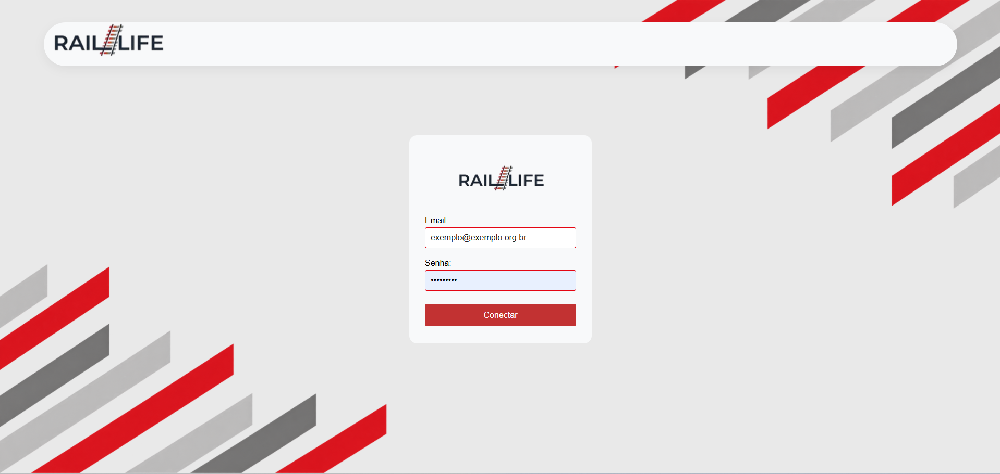
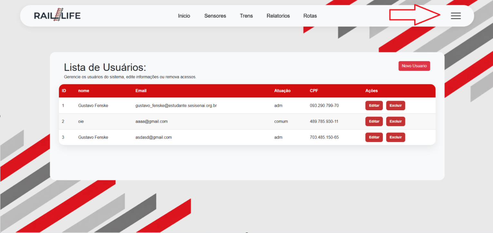
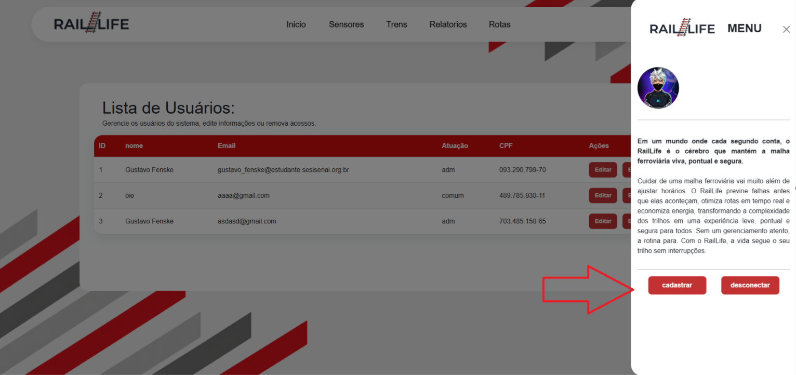
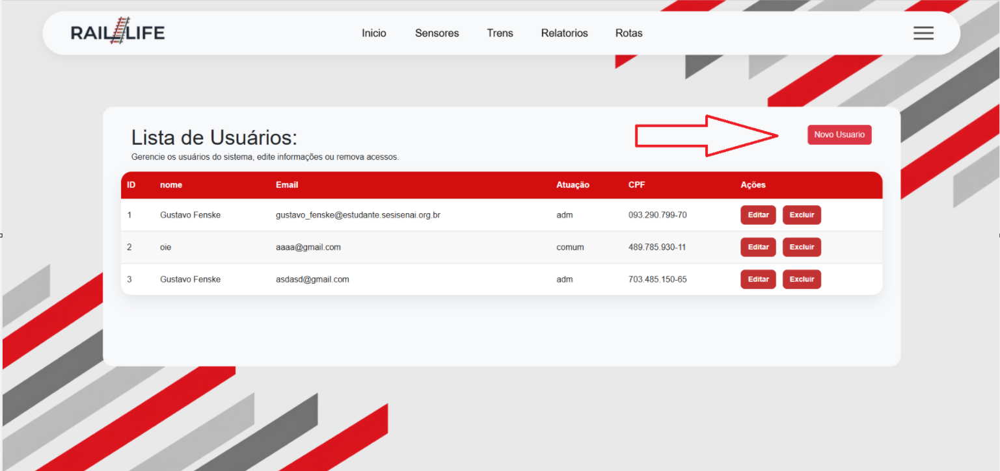
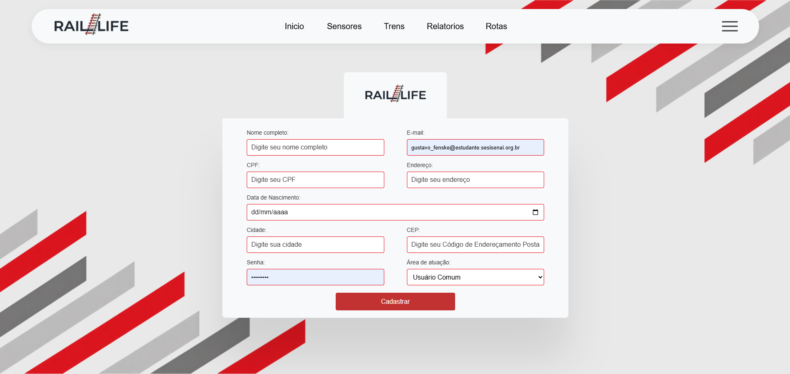
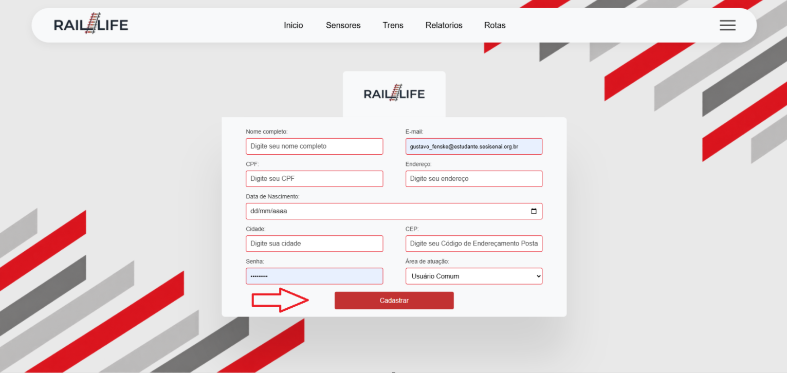
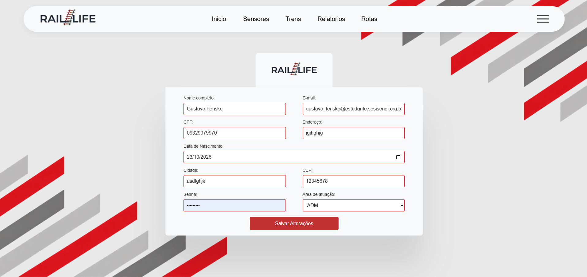
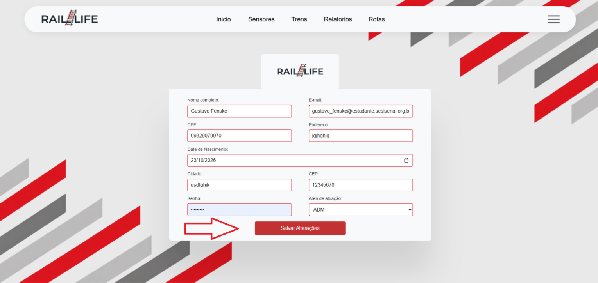
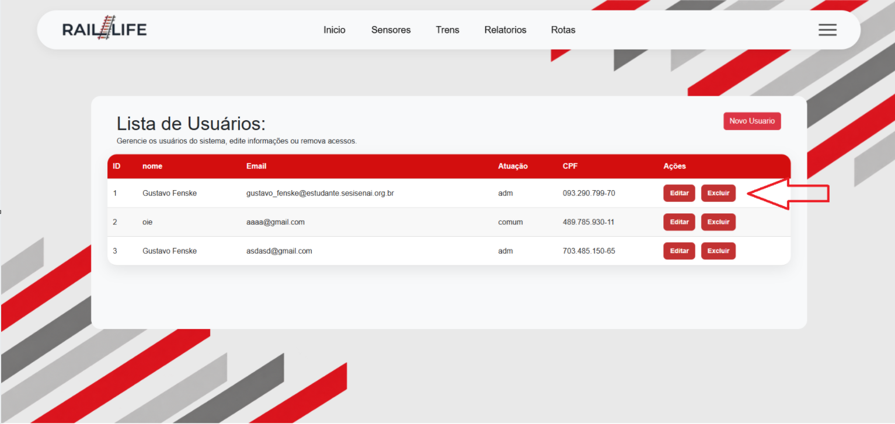
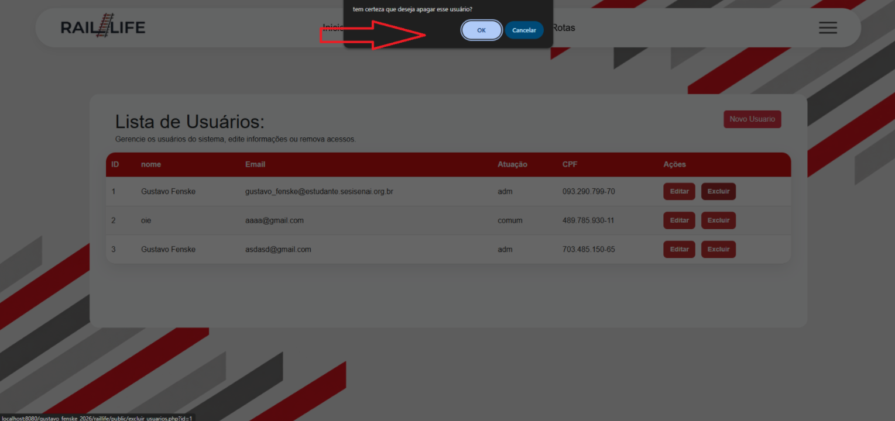

# Manual do Administrador - Raillife

> **Documentação Técnica e Operacional de Administração**

---

### Informações do Documento

| Campo | Detalhes |
| :--- | :--- |
| **Produto** | RAILLIFE - Sistema Ferrovia Inteligente |
| **Versão do Sistema** | 1.0 |
| **Fabricante / Desenvolvedor** | RailTech Solutions Ltda. |
| **Data de Emissão** | Setembro / 2026 |

---

## Sumário / Índice de Navegação

- [1. Introdução](#1-introdução)
  - [Apresentação Geral do Produto](#apresentação-geral-do-produto)
  - [Público-Alvo](#público-alvo)
- [2. Instruções de Uso para Administradores](#2-instruções-de-uso-para-administradores)
  - [2.1. Acesso ao Painel Administrativo](#21-acesso-ao-painel-administrativo)
  - [2.2. Gerenciamento de Usuários e Permissões (RBAC)](#22-gerenciamento-de-usuários-e-permissões-rbac)
    - [Criação de Usuários](#criação-de-usuários)
    - [Edição de Usuários](#edição-de-usuários)
    - [Excluir Usuários](#excluir-usuários)
    - [2.2.1. Níveis de Acesso](#221-níveis-de-acesso)
  - [2.3. Funcionalidades Principais de Controle](#23-funcionalidades-principais-de-controle)
- [3. Dicas e Boas Práticas](#3-dicas-e-boas-práticas)
  - [Cuidados no Manuseio do Sistema](#cuidados-no-manuseio-do-sistema)
  - [Recomendações para Uso Seguro](#recomendações-para-uso-seguro)
- [4. Solução de Problemas (FAQ)](#4-solução-de-problemas-faq)
- [5. Suporte e Contatos](#5-suporte-e-contatos)

---

## 1. Introdução

### Apresentação Geral do Produto
O **RAILLIFE** é uma solução de ponta projetada para otimizar a logística ferroviária, monitorar o tráfego de composições em tempo real, gerenciar alertas de telemetria, sinalização e garantir a máxima eficiência nas malhas operacionais. A plataforma integra sensores IoT de via, sistemas de bordo e algoritmos preditivos para prevenção de incidentes.

### Público-Alvo
Este manual destina-se exclusivamente a **Administradores de Sistema, Controladores de Tráfego e Gestores de TI/Operações** responsáveis pela manutenção, configuração de perfis, auditoria e tomadas de decisão estratégicas na rede ferroviária.

---

## 2. Instruções de Uso para Administradores

### 2.1. Acesso ao Painel Administrativo
Para acessar o console de administração, siga as etapas abaixo:

1. Acesse o endereço de login para se autenticar no site como administrador.
2. Insira suas credenciais corporativas (E-mail e Senha de Administrador).
3. Aperte no botão “Conectar”.

---

### 2.2. Gerenciamento de Usuários e Permissões (RBAC)
Como administrador, você pode gerenciar os operadores e técnicos no sistema:

#### Criação de Usuários

- Ao logar, você será direcionado automaticamente para a página de administração, mas para acessar ela de outro campo, clique nos três traços no canto superior direito e aperte em cadastrar:

- Na página de administração vai haver um botão escrito “+ Novo Usuário”, clique nesse botão você vai ser redirecionado para a página de cadastro de usuário:

- Formulário de cadastro de usuário:

- Preencha os campos de nome, email, CPF, data de nascimento, CEP, endereço, cidade e senha:

- Depois de certificar que todos os dados estão corretos, aperte no botão cadastrar e você voltará para a página de administração.

---

#### Edição de Usuários

- Na página de administração de usuários vai haver um botão escrito “Editar”, clique nesse botão você será redirecionado para a página de editar usuário:

- Formulário de edição de usuário:

- Preencha os campos de nome, email, CPF, data de nascimento, CEP, endereço, cidade e senha com as devidas alterações:

- Depois de certificar que todos os dados estão corretos, aperte no botão de salvar e você voltará para a página de administração:

---

#### Excluir Usuários

Na página de administração vai haver um botão escrito “Excluir” com o ícone vermelho, clique nesse botão e você receberá uma mensagem de confirmação na tela para confirmar a exclusão. **Esse processo é irreversível!**

---

### 2.2.1. Níveis de Acesso

- **Administrador:** Acesso irrestrito a configurações do sistema relacionadas a cadastro, visualização, edição e exclusão de usuário. Acesso limitado a cadastro, edição e exclusão de trens, rotas e sensores.
- **Usuário:** Acesso restrito a cadastro, visualização, edição e exclusão de usuário. Acesso irrestrito a cadastro, edição e exclusão de trens, rotas e sensores.

---

### 2.3. Funcionalidades Principais de Controle

| Funcionalidade | Descrição da Operação Administrativa | Ação Recomendada |
| :--- | :--- | :--- |
| **Adicionar, editar e excluir um usuário** | Faz alterações em um cadastro existente | Verificar alertas amarelos/vermelhos no grid principal. |

---

## 3. Dicas e Boas Práticas

### Cuidados no Manuseio do Sistema
- **Validação Dupla:** Sempre confirme os parâmetros de informações do administrador antes de enviar comandos diretos de alteração de usuário.
- **Auditoria Regular:** Revise semanalmente a lista de usuários ativos para revogar acessos de colaboradores desligados ou transferidos.

### Recomendações para Uso Seguro
- **Política de Senhas:** Utilize senhas fortes com no mínimo 12 caracteres, alternando maiúsculas, minúsculas, números e símbolos. As senhas devem ser alteradas a cada 90 dias.
- **Uso de Conexões Seguras:** O acesso ao painel administrativo deve ser realizado obrigatoriamente via rede interna ou VPN corporativa criptografada.
- **Exportação de Dados:** O download de dados operacionais e relatórios estratégicos deve respeitar as diretrizes de LGPD e confidencialidade da empresa.

---

## 4. Solução de Problemas (FAQ)

| Problema / Erro | Causa Provável | Solução Recomendada |
| :--- | :--- | :--- |
| **Usuário já cadastrado** | O usuário já existe no banco de dados. | Verificar se o usuário já está cadastrado na lista de usuários cadastrados; se tiver, é possível apenas editar as informações. |
| **Informações incorretas** | Alguma informação passou como falso na validação de campos | Verificar a autenticidade das informações passadas pelo usuário e um possível erro de digitação |
| **Bloqueio de conta do administrador** | Múltiplas tentativas incorretas de senha ou falha de MFA. | Entre em contato com o Admin ou acione a equipe de Segurança da Informação para reset seguro. |
| **Lentidão na hora de cadastrar usuário** | Servidor com problemas | Comunicar o Admin e esperar até o problema se normalizar |

---

## 5. Suporte e Contatos

Se você encontrar problemas técnicos críticos ou precisar de suporte de nível 3 para o sistema, utilize os canais abaixo:

- **Portal de Chamados Técnicos:** [https://suporte.railtech.com.br](https://suporte.railtech.com.br)
- **Central de Atendimento Nível 3:** `0800-770-RAIL (7245)`
- **E-mail de Suporte Administrativo:** [suporte.admin@railtech.com.br](mailto:suporte.admin@railtech.com.br)
- **Plantão de Emergência Operacional (24/7):** Ramal Interno `9911` / Telefone: `(11) 4000-9911`
