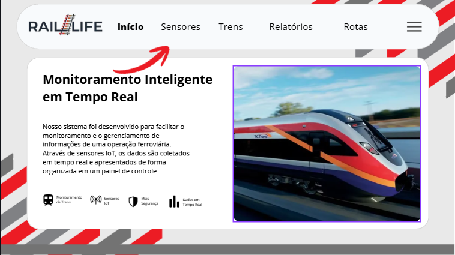
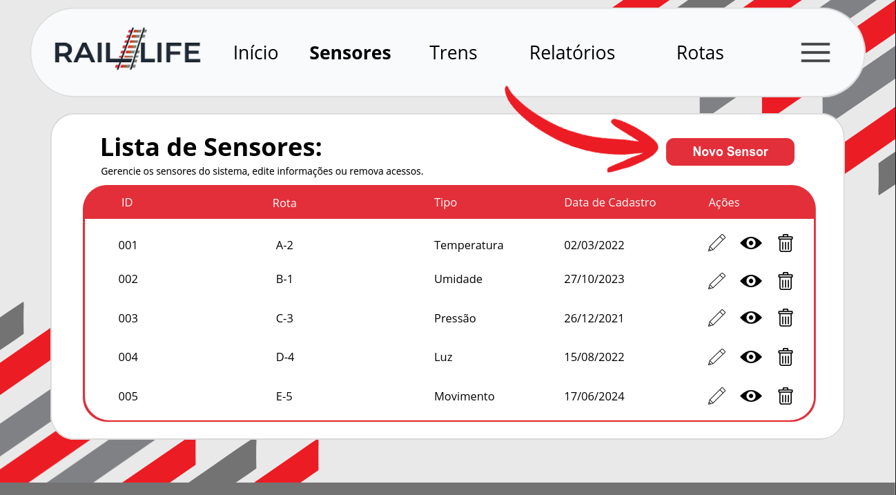
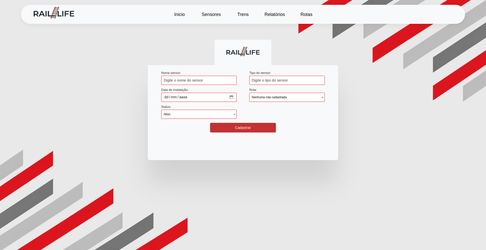
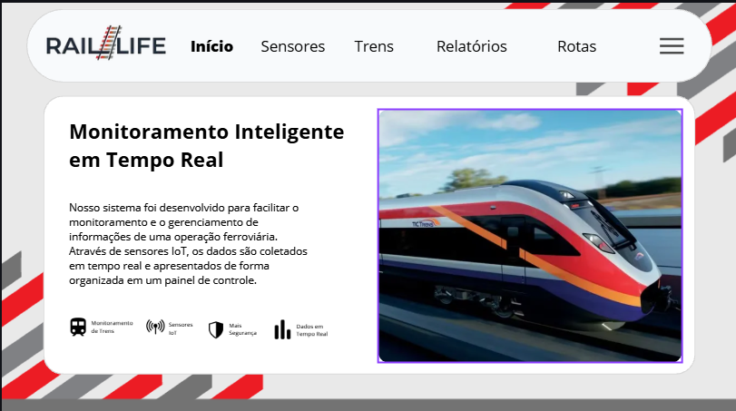
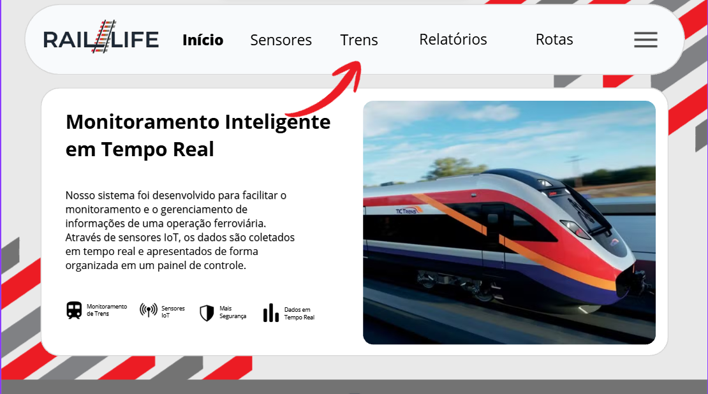
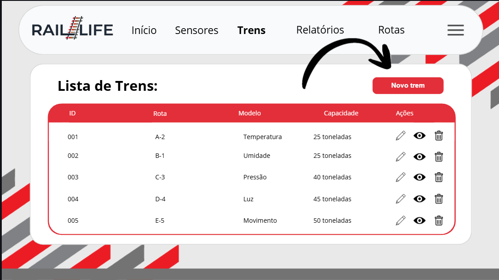
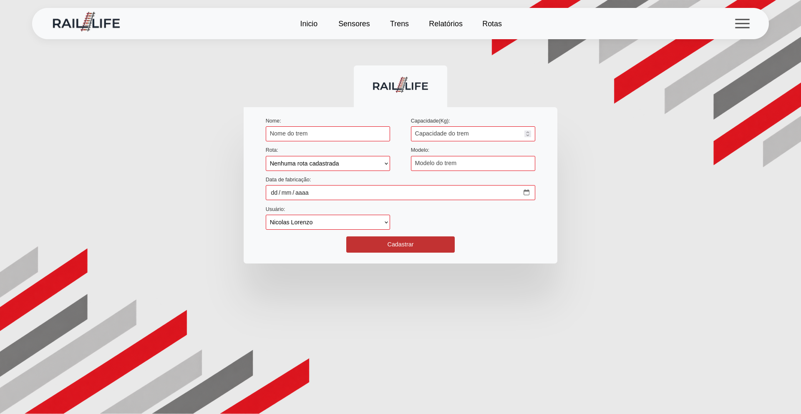

# Manual do Usuário - RAILLIFE - Sistema Ferrovia Inteligente

> **Guia rápido para utilização e acompanhamento das operações ferroviárias.**

---

### Informações do Documento

| Campo | Detalhes |
| :--- | :--- |
| **Produto** | RAILLIFE - Sistema Ferrovia Inteligente |
| **Versão do Sistema** | 1.0 |
| **Fabricante / Desenvolvedor** | RailTech Solutions Ltda. |
| **Data de Emissão** | Setembro / 2026 |

---

## Sumário / Índice de Navegação

- [1. Sobre o RAILLIFE](#1-sobre-o-raillife)
  - [Apresentação Geral do Produto](#apresentação-geral-do-produto)
  - [Público-Alvo](#público-alvo)
  - [O que o sistema permite acompanhar](#o-que-o-sistema-permite-acompanhar)
- [3. Instruções de Uso para Usuários](#3-instruções-de-uso-para-usuários)
  - [3.1. Acesso ao Sistema](#31-acesso-ao-sistema)
  - [3.2. Gerenciamento de Sensores](#32-gerenciamento-de-sensores)
    - [Cadastro de Sensores](#cadastro-de-sensores)
  - [3.3. Gerenciamento de Trens](#33-gerenciamento-de-trens)
    - [Cadastro de Trens](#cadastro-de-trens)
- [4. Dicas e Boas Práticas](#4-dicas-e-boas-práticas)
  - [Cuidados no Manuseio do Sistema](#cuidados-no-manuseio-do-sistema)
  - [Recomendações para Uso Seguro](#recomendações-para-uso-seguro)
- [5. Solução de Problemas (FAQ)](#5-solução-de-problemas-faq)
- [6. Suporte e Contatos](#6-suporte-e-contatos)

---

## 1. Sobre o RAILLIFE

### Apresentação Geral do Produto
O **Sistema Ferrovia Inteligente** é uma solução de ponta projetada para otimizar a logística ferroviária, monitorar o tráfego de composições em tempo real, gerenciar alertas de telemetria, sinalização e garantir a máxima eficiência nas malhas operacionais. A plataforma integra sensores IoT de via, sistemas de bordo e algoritmos preditivos para prevenção de incidentes.

### Público-Alvo
Este manual é direcionado a **usuários operacionais**. Configurações administrativas, gerenciamento de contas e permissões devem ser realizados pelos responsáveis autorizados da organização.

### O que o sistema permite acompanhar
- Trens Ativos.
- Sensores Ativos.
- Sensores Online.
- Rotas Ativas.
- Relatórios.
- Status Trens.
- Status Sensores.
- Atividades Recentes.

---

## 3. Instruções de Uso para Usuários

### 3.1. Acesso ao Sistema
Para acessar o site, siga as etapas abaixo:

1. Acesse o endereço seguro fornecido pela TI (ex: `https://RAILLIFE.com`).
2. No login insira suas credenciais corporativas (E-mail e Senha corporativos).
3. Acesse a página inicial (Home).

---

### 3.2. Gerenciamento de Sensores
Como usuário, você pode gerenciar o ciclo de vida dos sensores, trens e relatórios no sistema:

#### Cadastro de Sensores:

> **Passo 1:** Acessar a página inicial após o login com as credenciais válidas:

> **Passo 2:** Acessar a página **Sensores** através do menu de navegação:

> **Passo 3:** Clique em **“Novo Sensor”** para ser redirecionado para o formulário de cadastro do novo sensor:

> **Passo 4:** Formulário do sensor - Preencher campos corretamente:

> **Passo 5:** Após preencher o formulário clique em **Cadastrar** que você será redirecionado para a página anterior.

---

### 3.3. Gerenciamento de Trens
Como usuário, você pode gerenciar o ciclo de vida dos sensores, trens e relatórios no sistema:

#### Cadastro de Trens:

> **Passo 1:** Acessar a página inicial após o login com as credenciais válidas:

> **Passo 2:** Acessar a página **Trens** através do menu de navegação:

> **Passo 3:** Clique em **“Novo trem”** para ser redirecionado para a página de formulário de cadastro de trem:

> **Passo 4:** Formulário de Trens - Preencher campos corretamente:

> **Passo 5:** Após preencher o formulário clique em **Cadastrar** que você será redirecionado para a página anterior.

---

## 4. Dicas e Boas Práticas

### Cuidados no Manuseio do Sistema
- **Bloqueio de Sessão:** Bloqueie a estação de trabalho sempre que se ausentar da sala de controle.
- **Validação Dupla:** Sempre confirme os parâmetros de rota antes de enviar comandos diretos de alteração de agulha ou chaveamento.
- **Auditoria Regular:** Revise semanalmente a lista de usuários ativos para revogar acessos de colaboradores desligados ou transferidos.

### Recomendações para Uso Seguro
- **Política de Senhas:** Utilize senhas fortes com no mínimo 12 caracteres, alternando maiúsculas, minúsculas, números e símbolos. As senhas devem ser alteradas a cada 90 dias.
- **Uso de Conexões Seguras:** O acesso ao painel administrativo deve ser realizado obrigatoriamente via rede interna ou VPN corporativa criptografada.
- **Exportação de Dados:** O download de dados operacionais e relatórios estratégicos deve respeitar as diretrizes de LGPD e confidencialidade da empresa.

---

## 5. Solução de Problemas (FAQ)

| Problema / Erro | Causa Provável | Solução Recomendada |
| :--- | :--- | :--- |
| **Erro ao cadastrar sensores e trens** | O operador precisa cadastrar um novo sensor e digita os dados com um caractere errado. | Refazer a inserção porém com dados especificamente corretos. |
| **Erro 503 ao salvar alterações** | Instabilidade de rede. | Aguarde 60 segundos e tente novamente. Caso persista, verifique o status do servidor na aba "Diagnóstico". |
| **Latência de Interface** | Instabilidade de rede ou Perda de Pacotes. | Aguarde 60 segundos e tente novamente. Caso persista, entre em contato com uma equipe especializada e espere as instruções. |
| **Divergência nos dados de telemetria** | Calibração pendente nos sensores IoT instalados na via. | Agendar ordem de serviço para manutenção corretiva do sensor no módulo de Manutenção. |

---

## 6. Suporte e Contatos

Se você encontrar problemas técnicos críticos ou precisar de suporte de nível 3 para o sistema, utilize os canais abaixo:

- **Portal de Chamados Técnicos:** [https://suporte.railtech.com.br](https://suporte.railtech.com.br)
- **Central de Atendimento Nível 3:** `0800-770-RAIL (7245)`
- **E-mail de Suporte Administrativo:** [suporte.admin@railtech.com.br](mailto:suporte.admin@railtech.com.br)
